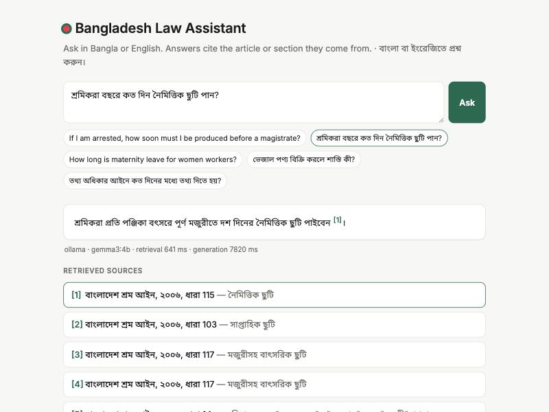

# Bangladesh Law Assistant

**Ask a legal question in Bangla or English. Get an answer that cites the exact article or section.**

A retrieval-augmented generation (RAG) assistant over the Constitution of Bangladesh, the Bangladesh Labour Act 2006,
the Consumer Rights Protection Act 2009 and the Right to Information Act 2009. Every answer cites its sources, and the
system is measured against an 88-question bilingual evaluation set.

[](https://github.com/MehediHasan19131/bangladesh-law-assistant/actions/workflows/ci.yml)



## Why

Most people in Bangladesh never read the laws that protect them. A garment worker may not know they are owed
10 days of casual leave; a shopper may not know adulterated goods carry up to 3 years in prison. The laws are public
on [bdlaws.minlaw.gov.bd](http://bdlaws.minlaw.gov.bd), but many are only in formal (সাধু) Bangla, and none are
searchable by question. This assistant answers in the user's language, quotes the law it relied on, and says
"I could not find this" instead of guessing.

## Results

Measured on the 88-question bilingual evaluation set described below. Full outputs are in [`results/`](results).

### Answers (local `gemma3:4b` via Ollama, top-6 dense retrieval)

| Metric | Score | What it checks |
|---|---|---|
| Fact accuracy | **98.7%** | the answer contains the expected fact (e.g. 10 days, 24 hours) |
| Grounded citations | **96.2%** | a cited source is the correct article/section |
| Citation rate | 98.7% | the answer cites at least one source |
| Language match | 100% | Bangla question → Bangla answer, English → English (even from Bangla-only laws) |
| False "not found" | 0% | answerable questions the assistant wrongly declined |
| Correct "not found" | 80% | off-topic questions (tax, passports, …) correctly declined |
| Latency | p50 12.3 s · p90 17.2 s | Apple M4 laptop, local 4B model |

The only fact miss: asked whether children can be employed, the model mixed up *children* (prohibited) with
*adolescents* (allowed with a fitness certificate). The two failed declines answered questions on Sanchayapatra
interest and driving licences from loosely related Labour Act sections instead of saying "not found".

### Retrieval: dense beats hybrid on a bilingual corpus

| Embedder | Mode | hit@1 | hit@5 | MRR@10 | Cross-lingual hit@5 |
|---|---|---|---|---|---|
| **BGE-M3** | **dense** | **0.910** | **0.987** | **0.941** | **1.00** |
| BGE-M3 | hybrid (BM25 + dense, RRF) | 0.744 | 0.910 | 0.835 | 0.67 |
| multilingual-E5-base | dense | 0.846 | 0.974 | 0.897 | 0.89 |
| multilingual-E5-base | hybrid | 0.731 | 0.885 | 0.801 | 0.22 |
| either | BM25 only | 0.641 | 0.795 | 0.707 | 0.00 |

Hybrid search is the usual default advice, but here it **hurt**. Keyword search can't match an English question to a
Bangla-only law (0% cross-lingual), and rank fusion lets its noise push correct dense results down. Lowering BM25's
weight in the fusion didn't help either (hit@1 fell steadily from 0.910 at weight 0 to 0.744 at weight 1), so the
service defaults to dense retrieval with BGE-M3. Hybrid and BM25 remain available as `mode` options.

### What the evaluation changed

| Iteration | Change | Effect |
|---|---|---|
| 1 | Bilingual "not found" rule in the system prompt | Local model replied in the wrong language and declined questions whose answer it had been given |
| 2 | Reply language + one "not found" sentence placed next to the question | Fixed: 100% language match, 0% false declines |
| 3 | Eval found citations written as `[১]` (Bangla digits) being ignored | Parser and UI accept Bangla digits; regression test added |
| 4 | Eval found a correct answer ("seat becomes vacant") marked wrong | Grader fixed (expected facts widened) |
| 5 | Prompt rule against answering from "merely related" sources | **Reverted**: declines unchanged at 80%, fact accuracy fell 98.7% → 94.9% |

Each change was kept only if it improved the numbers. Run logs for the reverted and earlier runs are in
[`results/iterations/`](results/iterations).

## How it works

```
bdlaws.minlaw.gov.bd ─► ingest.py ─► 819 sections ─► index.py ─► 988 chunks ─► BGE-M3 embeddings
 (5 acts, EN + BN)       parse HTML, footnotes,       split long sections        multilingual, so an English
                         repeals, section numbers     at clause boundaries       question finds Bangla law

question ─► top 6 chunks (dense) ─► prompt with numbered sources ─► Claude or local Gemma ─► answer + [n] citations
                                      reply language + "not found"                           mapped back to sections
                                      sentence chosen per question
```

- **Section-aware ingestion.** The official site serves UTF-16 HTML with amendment footnotes inline. The parser
  strips footnote markers, drops repealed sections, and normalizes numbering (Bangla ৭ক → 7A) so the English and
  Bangla Constitution share IDs.
- **Citations are checked, not trusted.** The model cites `[n]`. The service maps each number back to a chunk, drops
  out-of-range numbers, and the evaluation checks the cited section is actually the right one.
- **Two LLM backends behind one interface.** Claude (`claude-opus-5-5`, via the Anthropic SDK, with server-side
  refusal fallback) when an API key is set, otherwise a free local model through Ollama (`gemma3:4b`).
- **Evaluation-driven decisions.** The retrieval mode, the embedding model and the prompt layout were each chosen by
  measuring them on the eval set.

## Evaluation set

[`eval/questions.jsonl`](eval/questions.jsonl): 88 questions, each labelled with its correct section(s) and the
key facts a correct answer must contain (e.g. "২৪" / "twenty four" hours for arrest).

| Category | Count | Example |
|---|---|---|
| English → Constitution | 27 | If I am arrested, how soon must I be produced before a magistrate? |
| Bangla → Constitution | 12 | সংসদ সদস্য হওয়ার জন্য ন্যূনতম বয়স কত? |
| Bangla → Labour Act | 16 | শ্রমিকরা বছরে কত দিন নৈমিত্তিক ছুটি পান? |
| Bangla → Consumer Rights Act | 8 | ভেজাল পণ্য বিক্রি করলে শাস্তি কী? |
| Bangla → Right to Information Act | 6 | তথ্য অধিকার আইনে আবেদন করলে কত দিনের মধ্যে তথ্য দিতে হয়? |
| **Cross-lingual**: English question, Bangla-only law | 9 | How long is maternity leave for women workers? |
| **Unanswerable**: not covered by these laws | 10 | What is the income tax rate for individuals? |

All answer checks are deterministic (string and citation matching), so the whole suite can re-run for free after any
change. The questions were drafted with an AI assistant from the section texts, and every gold label was checked
against the parsed corpus.

## Quick start

```bash
python -m venv .venv && source .venv/bin/activate
pip install -e ".[dev]"

python -m lawrag.ingest                  # download + parse the laws → data/sections.jsonl (already committed)
python -m lawrag.index                   # embed with BGE-M3 → index/
ollama pull gemma3:4b                    # free local model (or: export ANTHROPIC_API_KEY=...)
uvicorn lawrag.api:app                   # http://localhost:8000
```

Or with Docker: `docker compose up` (starts the app plus an Ollama container; set `ANTHROPIC_API_KEY` to use Claude).
The Docker setup has not been test-built yet; the local setup above is the tested path.

**Command line:**

```bash
python -m lawrag.rag "শ্রমিকরা বছরে কত দিন নৈমিত্তিক ছুটি পান?"
python -m lawrag.evaluate retrieval --index index --index index-e5    # compare embedders and search modes
python -m lawrag.evaluate answers --provider ollama                   # end-to-end answer quality
```

**API:** `POST /api/ask {"question": "...", "k": 6, "mode": "dense"}` · `GET /api/search?q=...` · `GET /api/health`

## Project layout

```
src/lawrag/
  ingest.py     scrape + parse bdlaws pages into sections
  text.py       Bangla/English normalization, tokenizer, light Bangla stemmer
  index.py      chunking, BM25, dense embeddings, rank fusion
  llm.py        Claude (Anthropic SDK) and Ollama providers
  rag.py        prompt, generation, citation mapping
  api.py        FastAPI service
  evaluate.py   retrieval + answer evaluation
static/         single-page chat UI
eval/           questions with gold sections and expected facts
results/        evaluation outputs
tests/          28 tests: parsing, stemming, retrieval, citations, API (fake model, no downloads)
```

## Limitations

- **Small corpus by design:** five laws, current as published on bdlaws. Amendments after the scrape are not included.
- **Evaluation set is small** (88 questions) and written from the section texts, so it is easier than real user
  questions. Fact checks are string matches: they can miss a correct paraphrase or accept a wrong answer that
  happens to contain the number.
- **The local 4B model is the weak link** (see results). It sometimes cites in the wrong format or misreads a
  clause. Claude closes most of that gap but needs an API key.
- Not legal advice.

## Next steps

- LLM-as-judge scoring of faithfulness, and a CI gate that fails a pull request when eval scores drop.
- More acts (Penal Code, Code of Criminal Procedure, Digital Security / Cyber Security law, Road Transport Act).
- Run the same evaluation with Claude to quantify the gap to the local model.
- Reranker on the top 20, and evaluation of chunk sizes.

## License

MIT for the code. Law texts are public documents from the Government of Bangladesh.
